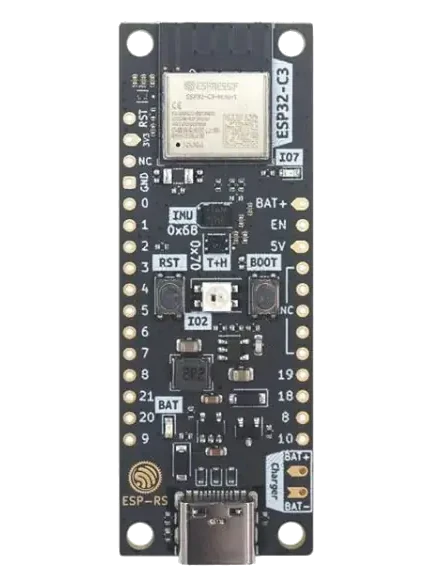

# ESP32
 ESP32 is a series of low cost, low power microcontrollers with IoT capabilties (Wi-Fi, BLE, IEEE802.15.4). ESP32 is created and developed by the chinese company Espressif Systems. Their boards are wide-spread both among hobbyists and in industry, as they have a low entry-barrier and their SDK is well maintained.
 
 This repository contains starting points and references for the ESP32 for the course Embedded Software for the Internet of things at University of Trento, whose [main repository can be found here](https://github.com/sinanyil81/Embedded-Systems/tree/main)

## IDE
We recommend using one of three options for developing on ESP32s:
    1. Use VSC with the Espressif IDE extension
    2. Program in the IDE of your choice and compile/build/debug [using the terminal / CLI](references/useful_cmds.txt). 
    3. Use the dedicated [Espressif-IDE](https://docs.espressif.com/projects/espressif-ide/en/latest/downloads.html)(external), which is based on Eclipse
    
## Software Development Environment
- Download & install the software framework:  [Installation & Getting Started](https://docs.espressif.com/projects/esp-idf/en/stable/esp32/get-started/index.html)(external)
- [API Documentation](https://docs.espressif.com/projects/esp-idf/en/stable/esp32/api-reference/index.html)(external)

## Equipment provided by the University
- MCU: [ESP32-C3-MINI-1 Datasheet](references/esp32-c3-mini-1_datasheet_en.pdf)
- Development Kit: [ESP32-C3-DevKit-RUST-2](references/esp-dev-kits-en-master-esp32c3.pdf)

## Examples
### Basic
- [LED Blink](examples/blink)
- [ESP timer](examples/esp_timer)
### Periherals
- [Temperature Sensor](examples/temp_sensor)
### Connectivity
#### BLE
In order to allow your phone to observe broadcast BLE packets, download the app: [nRF Connect](https://www.nordicsemi.com/Products/Development-tools/nRF-Connect-for-mobile)
- [BLE pingpong](examples/ble_pingpong)
The pingpong example allows exchanging a connection-less BLE packet between two nodes. You can also observe these packets in the app.
- [BLE + mobile phone](examples/ble_mobile)
This is the default ESP example found under 
#### WIFI
- [WIFI](examples/wifi)
This example is not appropriate for Eduroam, because it is a WPA-2 Enterprise network, which requries specific certificates. Instead, you can test this on your phones hotspot or your home wifi.
For this, one must first configure the WIFI SSID and password using idf.py menuconfig. Follow the instructions in its [readme](examples/wifi/README.md)
For using eduroam, refer to the example given in ~/.espressif/v6.1/esp-idf/examples/wifi/wifi_enterprise/ or in the [esp github repository](https://github.com/espressif/esp-idf/tree/master/examples/wifi/wifi_enterprise) 

#### Other Examples
Default examples can be found locally under ~/espressif/v6.1/esp-idf/examples or the official [github](https://github.com/espressif/esp-idf/tree/master/examples)
### Extension Boards
- [ESP-EYE (TODO)]

## Other references
- [Timer](https://docs.espressif.com/projects/esp-idf/en/latest/esp32/api-reference/system/esp_timer.html)(external)
- [Temperature (on board)](https://docs.espressif.com/projects/esp-idf/en/stable/esp32s3/api-reference/peripherals/temp_sensor.html)(external)
- [BLE doc](https://mynewt.apache.org/latest/network/ble_hs/ble_hs.html)(external)
- other [BLE examples](https://github.com/espressif/esp-idf/tree/master/examples/bluetooth/ble_get_started/nimble)(external)
- [WIFI](https://docs.espressif.com/projects/esp-idf/en/latest/esp32c3/api-reference/network/esp_wifi.html)(external)
- All [default examples](https://github.com/espressif/esp-idf/tree/master/examples)(external)
